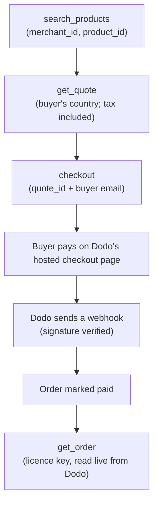

# OpenMoR

[](https://github.com/PrafulK99/openmor/actions/workflows/ci.yml)
[](LICENSE)

Open-source layer that lets AI agents discover, quote, buy and receive digital products from merchants who sell through a merchant of record (MoR). [Dodo Payments](https://dodopayments.com) is the first provider.

## What it does

- An agent **discovers** products across merchants (search and details).
- It gets a **quote with tax** for the buyer's country, from the provider's checkout preview, not a guess.
- It **hands the buyer to a hosted Dodo checkout**. The buyer pays on Dodo's page; no card data touches OpenMoR.
- Once the buyer has paid, the agent **receives the licence key** (and subscription or credits details), read live from Dodo.

## How a purchase works



- Agents never send amounts: `checkout` takes a `quote_id`. A quote is valid for 15 minutes.
- `checkout` is idempotent: the same quote and buyer email return the same order and link.
- `get_order` returns the licence key only when called with the buyer's checkout email.

## Try it

> **The live catalog is a test catalog.** The merchant on it is in Dodo test mode: its products and checkout links are for testing only, and nothing there is a real purchase. Its products are marked `[TEST]`.

Connect an agent to the live connector. With [Claude Code](https://claude.com/claude-code):

```sh
claude mcp add --transport http openmor https://openmor.vercel.app/api/mcp
```

The connector offers five tools: `search_products`, `get_product`, `get_quote`, `checkout`, `get_order`. Then ask the agent to find a product and quote it for a country such as Germany.

Look at the same catalog as a person or a crawler would:

| What | URL |
| --- | --- |
| Merchant page (HTML) | <https://openmor.vercel.app/m/sharethings> |
| Markdown twin of that page | <https://openmor.vercel.app/m/sharethings.md> |
| `llms.txt` for the network | <https://openmor.vercel.app/llms.txt> |
| UCP profile | <https://openmor.vercel.app/.well-known/ucp> |

Details of each: [docs/public-pages.md](docs/public-pages.md) (pages, twins, `llms.txt`, sitemap) and [docs/ucp-acp.md](docs/ucp-acp.md) (UCP catalog).

## Demo

> **Demo video: placeholder.** A walkthrough will be linked here once it is recorded.

## Architecture

```
src/
  core/            quotes, checkout, orders, fulfillment: one core, no provider code
  adapters/dodo/   the only code that imports the Dodo SDK
  protocols/mcp/   MCP tools (call core only)
  protocols/ucp/   UCP profile and read-only catalog (call core only)
  app/             Next.js routes: readable pages, markdown twins, llms.txt, API routes
  lib/             database client, crypto, env
```

- **One core.** Every front door calls the same quote, checkout and order logic.
- **Protocol layers:** the MCP connector, the agent-readable pages (with `llms.txt`), their markdown twins, and the UCP read-only catalog.
- **Provider adapters** sit behind a `ProviderAdapter` interface ([src/core/types.ts](src/core/types.ts)). Only the Dodo adapter imports the Dodo SDK.
- Stack: Next.js (App Router) and TypeScript, Prisma on Postgres (Supabase), `zod`, `vitest`. Deployment: [docs/deploy.md](docs/deploy.md).

## Security at a glance

- **No card data.** Buyers pay on Dodo's hosted checkout page every time.
- **Merchant Dodo API keys are encrypted at rest** (AES-256-GCM, key from the `ENCRYPTION_KEY` environment variable) and never returned by any API or tool.
- **Webhooks are verified** (Standard Webhooks signature) before anything in them is trusted; bad signatures get a 401.
- **Checkout is idempotent**, and a quote is marked used only after Dodo has created the checkout session.
- **Test mode is the default.** Live mode needs an explicit per-merchant flag.
- **Rate limiting is enforced at the edge** by a Vercel Firewall rule: a 60 s fixed window, 100 requests per IP, on `/api/mcp` and `/ucp/`; over the limit gets a 429. The rule is set in the Vercel dashboard, and its details are in [docs/deploy.md](docs/deploy.md#rate-limiting).
- **Merchant text is data:** length-limited, escaped, and never placed in links or instructions ([docs/public-pages.md](docs/public-pages.md#merchant-text-is-data)).
- Security headers (including a Content-Security-Policy) are set on every route.

More: [docs/](docs/). Report vulnerabilities privately as described in [SECURITY.md](SECURITY.md), not in public issues.

## What it can't do yet

- **The buyer pays on Dodo's hosted page every time.** Agent-initiated repeat purchases (charging a saved card later, with no buyer present) are blocked because Dodo does not currently expose a reusable saved method for one-time checkouts. What was tested, and what would unblock it: [docs/dodo-saved-payments.md](docs/dodo-saved-payments.md).
- **UCP is a read-only catalog.** It can search and look up products; there is no UCP checkout, order or payment handler. An ACP product feed is deferred ([docs/ucp-acp.md](docs/ucp-acp.md)).
- **Merchant onboarding is done by maintainer scripts** (`pnpm merchant:add`, `merchant:sync`, `merchant:sellable`, `merchant:webhook`). There is no merchant dashboard yet.
- Dodo Payments is the only provider so far.

## Roadmap

No dates are promised.

- A merchant dashboard (sign-in, connect a Dodo key, choose products, opt in).
- More provider adapters.
- Agent-initiated repeat purchases, only if a provider exposes reusable saved methods.

## Contributing

See [CONTRIBUTING.md](CONTRIBUTING.md).

## License

[Apache-2.0](LICENSE) © 2026 Praful Kharpuriye ([@PrafulK99](https://github.com/PrafulK99)).
